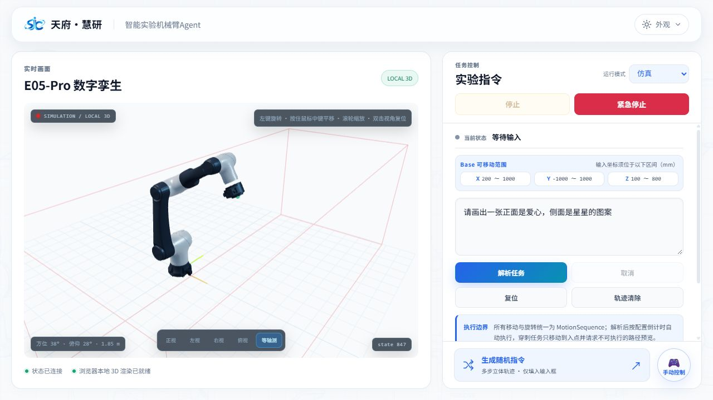
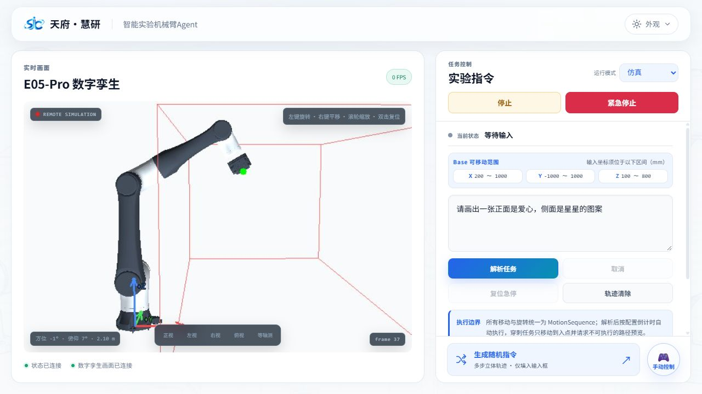

# 外部开发接入验证

## 2026-10-28 材料可靠性修复

指定材料服务已加载通过隔离验收的 15 个源码文件，公开配置为 114 个组件、41 条事件，三个 Agent 页面均返回 HTTP 200。材料独立包保持 16 个原业务回调。

Word 原文 12 问及两轮额外综合三步共 18/18 独立源证据验收通过；129 项相关后端回归、22 项界面回归、15 项上传状态回归和两套前端构建通过。上传确认不再依赖 WebCrypto，使用路径集合与队列事件回执。

隔离浏览器完成四 PDF 上传 100%/4-of-4、追加、清除验证。部署后公网接口已完成综合初筛与四篇预览，确认分析接口复验进行中。本机 Chrome 自动化因无法可靠识别当前 URL 被安全机制停止，未将该项标为通过。完整范围见 [材料验证记录](../materials-ui/docs/verification.md)。

## 2026-10-27 医学与机械臂同步验证

在开发电脑上启动仓库的门户与机械臂 Vite 服务，连接公开线上入口；未依赖 SSH 隧道。源码同步范围见 [同步记录](online-sync-20261027.md)。

| 检查 | 结果 |
| --- | --- |
| 当前线上版本 | 两个公开入口 HTML/JS 与各自部署目录一致，包含四川场景/历史会话检查与本地 3D 新界面 |
| 代理回归 | 15 项通过；新增两套 Vite 的 STL 二进制转发与来源拒绝检查 |
| 医学接口 | 状态、四川场景问题、POST 来源检查、真实 SSE、有效/无效回答 ID 的会话检查全部通过 |
| 医学浏览器 | 旧历史显示重新提问提示；重新询问和场景点击均能预填；新回答完成并进入可追问状态，资料和推荐正常 |
| 机械臂接口 | 健康、ASR、独立会话、WebSocket、六段有效渲染姿态和七个二进制 STL 模型全部通过 |
| 机械臂浏览器 | 显示状态已连接和本地 3D 渲染已就绪；等轴测预设改变浏览器视角，模型可见 |
| 材料接入回归 | 页面/API root、契约、合成 CSV 上传/下载和 Gradio 队列 SSE 通过 |
| 构建 | 两套 TypeScript/Vite 构建与根目录静态合并通过 |
| 发布范围 | `check:source` 通过；不含后端业务、凭据、真实环境文件、服务配置或安装依赖 |

本次同步未重启或修改线上服务。机械臂只检查状态、模型和浏览器相机，未验证运动、使能、暂停/继续或复位等设备操作；这些入口按当前线上源码保留。两个页面浏览器控制台未记录 error。

医学完成回答并允许追问：

机械臂状态和浏览器 3D 模型均已连接：

## 2026-10-19 首次外部接入验证

验证日期：2026-10-19。测试客户端在开发电脑上，通过两个本地 Vite 服务器连接公开线上入口，不依赖 SSH 隧道。Node.js 24；门户 Vite 6.4.4，机械臂 Vite 5.4.14；线上 Gradio 6.17.3。

| 检查 | 结果 |
| --- | --- |
| 代理回归 | 13 项通过；包含两套 Vite 实例及其子项 |
| 医学 | 状态、推荐问题、POST 来源通过、真实问答 SSE 完整结束 |
| 材料 | 页面及本地 API root、公开契约、真实 CSV 上传/下载、Gradio 队列 SSE 完成 |
| 机械臂 | 健康、ASR 状态、新建隔离会话、会话读取、遥测、WebSocket 消息、MJPEG 首段 |
| 浏览器 | 本地医学页面解答完成、材料工作台初始化、机械臂显示状态和数字孪生画面已连接 |
| 构建 | 门户和机械臂 TypeScript/Vite 构建通过 |
| 新克隆交接复现 | 从只含已提交源码的新克隆执行 setup、connect:online、两个 dev 入口及完整线上自检，全部通过；无需原工作区私有文件 |

机械臂测试没有发送运动、使能或手动控制指令。材料测试使用合成 CSV；本次目标是接口接入，未修改材料业务算法。线上来源校验保持原样。

可复现步骤见 [外部开发接入](external-development.md)。测试脚本会检查当前服务是否可用，历史通过结果不代表服务永久在线。

## 浏览器实际结果

医学页面从本地提交问题，并收到线上完整回答：

本地材料入口通过代理加载线上 Gradio 工作台：

本地机械臂前端连接线上只读状态与仿真画面：

