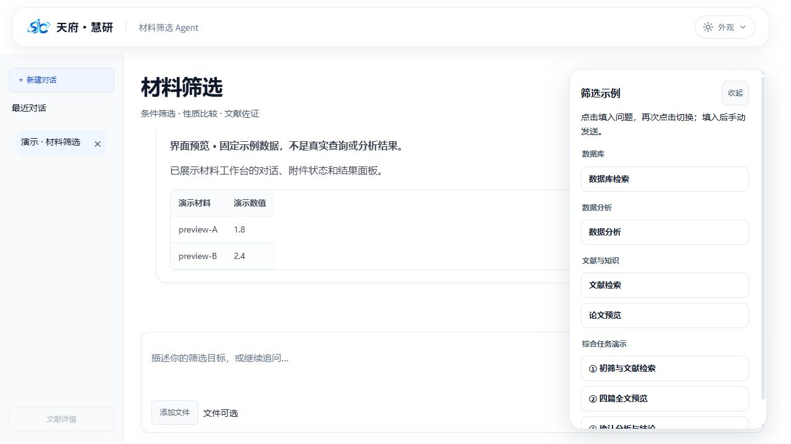

# 材料筛选 Gradio 界面开发包

此目录包含可独立启动的 Gradio 界面定义、原有事件绑定、样式、示例问题、预览入口和交接资料。界面代码同步于 2026-10-27 当前线上版本，继续使用 Gradio，不转换为 React。

业务处理通过 `UiCallbacks` 注入。模型、检索、材料数据库、统计分析实现、生产会话存储、密钥和服务器配置不在包内。

如果只需从 GitHub 下载后连接现有线上材料业务，使用仓库根目录的 [外部开发接入流程](../docs/external-development.md)，从 `127.0.0.1:5173/agent/materials/` 打开线上工作台。以下 `preview.py` 则用于本地修改界面，二者不要混用。

## 启动本地预览

需要 Python 3.10 或更新版本。本包固定使用与当前材料界面一致的 Gradio 6.17.3 / gradio_client 2.5.0，已在 Python 3.13 下验证。

Windows PowerShell：

```powershell
cd materials-ui
python -m venv .venv
.venv\Scripts\python.exe -m pip install -r requirements.txt
.venv\Scripts\python.exe preview.py
```

macOS / Linux：

```sh
cd materials-ui
python3 -m venv .venv
.venv/bin/python -m pip install -r requirements.txt
.venv/bin/python preview.py
```

打开 `http://127.0.0.1:7865/`。端口冲突时可加 `--port 7866`。预览只绑定本机，不生成公网分享链接，不需要 Node.js 或现有业务服务。

预览使用明确标记的虚构数据，上传文件只展示文件名，不解析真实文档。它演示界面行为，不提供真实材料筛选、文献检索或统计结果；历史预览使用两类固定样例，仅在本页产生相应预览后列出，不保存真实业务会话。

## 目录与修改位置

```text
app.py                       对外导出 create_ui / UiCallbacks 等入口
preview.py                   本地固定数据预览
requirements.txt             界面依赖版本
materials_ui/
  layout.py                  Gradio 布局、控件与隐藏状态
  events.py                  发送、停止、恢复、上传、分页等事件链
  interaction.py             页面代次、请求取消与最近条目浏览器事件
  contracts.py               16 个必需回调及界面默认值
  assets.py                  样式、主题和本地 Logo 加载
  examples.py                示例问题及会话独立的切换游标
  preview_handlers.py        只返回固定样例的预览回调
styles/                      基础、主题、布局、workspace 与 presentation CSS
assets/                      本包独立运行所需的 banner CSS 与 Logo
fragments/                   当前 banner/head HTML 参考片段
scripts/theme.js             浏览器主题与菜单交互
fixtures/                    虚构表格、图表和报告
tests/                       界面契约快照及预览回归
docs/                        修改指南、回调签名及业务接入说明
```

- 改字体、颜色、间距：编辑 `styles/`；公共 banner 样式位于 `assets/agent-masthead.css`，由 head 内联加载。
- 改组件排列、文案、默认显隐：编辑 `materials_ui/layout.py`。
- 改示例按钮及轮换问题：编辑 `materials_ui/examples.py`。
- 改按钮联动和流程：编辑 `materials_ui/events.py`，同步维护回调契约。
- 接真实服务：使用自己的处理函数构造 `UiCallbacks`，详见 [接入说明](docs/integration.md)。

`assets.py` 将 Logo 和样式嵌入预览，复制整个 `materials-ui` 目录即可使用，不依赖仓库外层的 `shared/` 或原网站资源路径。CSS 按线上组合顺序加载；head 保留线上模板，将其中的公共 banner 样式引用替换成相同内容的内联样式。

## 快速检查

```powershell
.venv\Scripts\python.exe preview.py --check
.venv\Scripts\python.exe -m unittest discover -s tests -v
```

`tests/ui_contract.json` 记录本次提取的组件属性、事件输入输出、初始化链及取消关系，用于避免修改界面时意外丢失功能。18 项回归不需要业务服务。

预览操作：输入“预览材料”查看流式回答；输入“预览文献”展开文献详情并翻页；上传 `fixtures/preview-materials.csv` 或输入“预览数据”检查高级面板、图表和下载。输入“演示错误”可查看错误反馈。

本包保留 114 个组件、40 条事件绑定和 16 个外部业务回调接口。原业务功能通过原回调继续提供；不要用 `preview_handlers.py` 替代生产业务处理。

交接步骤见 [修改指南](docs/handoff.md)，生产接入见 [回调接口说明](docs/integration.md)。

本次校验结果见 [验证记录](docs/verification.md)。以下为独立预览的实际截图：


