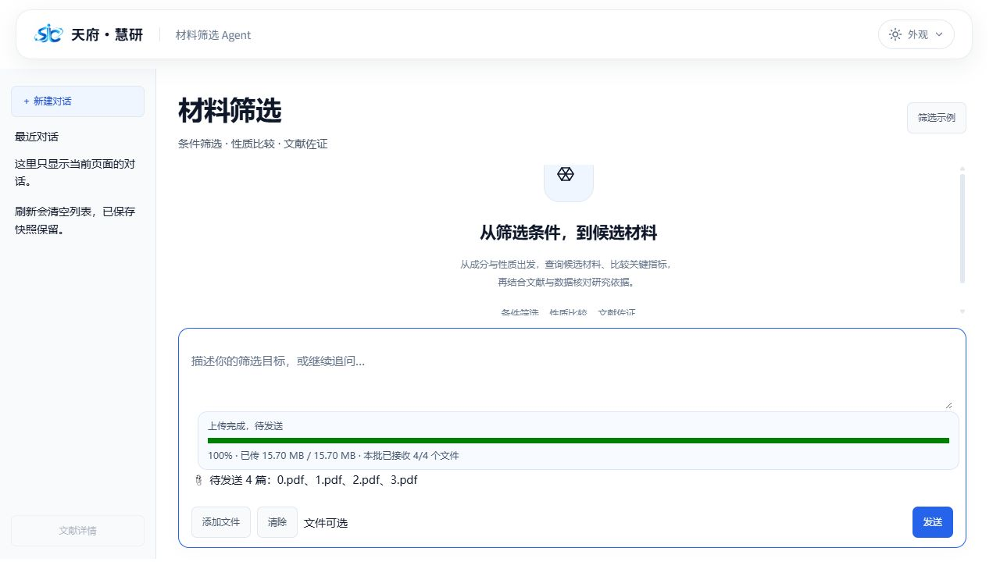

# 材料界面与真实流程验证记录

日期：2026-10-28。材料服务使用指定项目源码，Gradio 6.17.3 / gradio_client 2.5.0；服务 Python 3.12.15，本地预览 Python 3.13。

## 修复内容

- 上传确认取消 WebCrypto 依赖；传输完成显示100%，附件回调成功后才显示待发送；多批追加、事件早到及清除后的旧事件分别处理。
- 服务侧统一规划参数约束、纠错反馈与唯一工具协议，将已校验的分析程序交给真实计算工具执行，保留证据验证。
- 文献候选排除明确的审稿回复、决定信等文种，旧缓存回退同样过滤。
- 论文题名由可信原文标题块支持，避免期刊标识和排版文件名冒作题名；新任务按版本隔离旧预览缓存，不删除历史数据。
- 最终报告保留每篇已确认论文的处理结果、真实记录数和未用于目标结论的限制说明，重复格式化不丢失覆盖表。

## 独立源证据验收

以用户提供的 Word 原文和配套资料为准，按原顺序保留同组会话；没有改测试题、原表、PDF或用固定演示答案替代执行。

| 组别 | 请求数 | 结果 |
| --- | ---: | --- |
| 数据库 | 3 | 查询范围、排序、Top-N、详情、比较、统计与 IQR 独立核对通过 |
| 表格分析 | 2 | 原文件21行、缺失/重复保留；数值与独立计算一致，两问复用同一实际数据集 |
| 文献检索 | 3 | 当前主题、年份、实际检索快照和原生展示投影核对通过，审稿回复不冒作实验论文 |
| 单篇预览 | 1 | 0.pdf 字节、页码与预览来源核对通过，未提前执行详细抽取 |
| 综合任务首轮 | 3 | 初筛与计算、四篇1–4.pdf预览、确认后的分析和结论通过 |
| 综合任务额外两轮 | 6 | 两个独立新会话中重复完整三步，任务、查询、原PDF、数值与引用链通过 |

合计18/18通过。源证据检查读取实际保存的查询、计算记录及不可变文件，不能仅凭有回答文本判断成功。综合三轮的四源覆盖、阶段确认与同会话绑定均通过；来源相同的成功缓存仍按字节、策略和授权重新核验。

## 代码与界面检查

- 129项相关后端回归通过，覆盖规划约束/协议、计算交接、来源/确认、文种、题名和公开报告覆盖。
- 22项独立界面回归通过；15项上传脚本回归通过，包含无WebCrypto、累计附件、事件竞争、失败恢复及旧事件隔离。
- 两套 React/TypeScript/Vite 构建通过；源码发布范围检查通过。
- 界面仍为114个组件、41条事件和16个业务回调，无新增业务网关或前端依赖。
- 隔离浏览器上传截图中的0–3.pdf显示100%、15.70MB、4/4；追加4.pdf后为本批1/1且附件共5篇；清除后旧反馈与旧附件均不再出现。

## 部署后验证范围

生产服务已加载15个经过基线及候选校验的源码文件，新上传脚本可从实际公开配置核对；医学、机械臂与材料页面均返回HTTP 200。实际公网接口综合三步复验完成：初筛、四篇预览、明确确认后的分析和结论输出均完成；只读核对生产任务为finished、四篇均included。

本机Chrome的自动化因无法可靠确定当前浏览器URL，被Computer Use安全机制停止；此项未计为通过，需要在实际浏览器中刷新页面进行人工复验。没有把隔离截图当作公网浏览器证据。

已将精确提交的界面包绑定生产业务回调再次构建，组件、事件图、CSS、head和banner样式全部一致，16个回调接口保持原样。

## 交付边界

GitHub只包含界面代码、资源、预览、测试和交接文档。后端规划、检索、分析、真实记录、用户提供的Word/Excel/PDF、密钥及服务器配置不上传。旧已保存报告不自动改写；新建任务或按原流程重新生成后使用新的题名和覆盖展示。

使用本包预览时仍是固定虚构数据；连接真实业务的方法见[integration.md](integration.md)。
